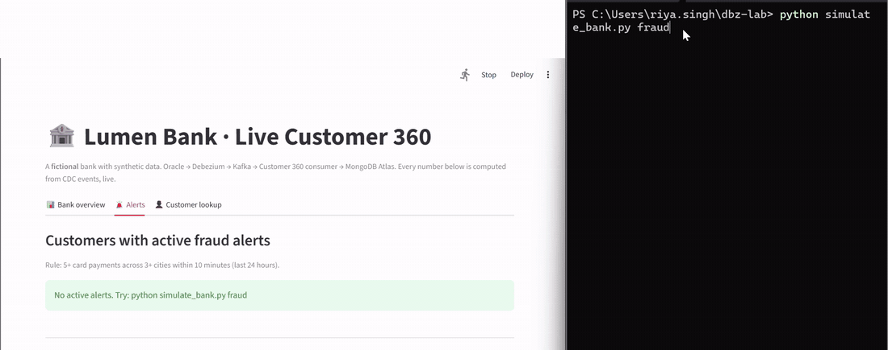
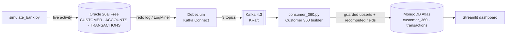

# Lumen Bank: Real-time Customer 360 with Oracle CDC

A simulated bank whose Oracle core system streams every change through **Debezium** and **Kafka** into a live **Customer 360** in **MongoDB Atlas**, with real-time spend profiles and fraud alerts, shown on a **Streamlit** dashboard. The whole stack starts with one command.



*Demo: `simulate_bank.py fraud` uses one customer's card in several cities within seconds. Debezium → Kafka → the Customer 360 consumer detects the pattern and the alert appears on the dashboard (the middle part is sped up 3×).*

> **Lumen Bank is fictional and all data is synthetic.** Built and run on a single laptop (Docker Desktop on Windows/WSL2) with a free-tier MongoDB Atlas cluster.

---

## The problem it solves

A bank's core system (here, Oracle) is the system of record, but:
- a customer's data is spread across many tables (profile, accounts, transactions),
- new applications aren't allowed to run heavy queries against the core database,
- reporting usually comes from overnight batch jobs, so it's hours old.

This project streams every committed change out of Oracle (**change data capture**, no changes to the core system) and maintains **one always-current document per customer** in a separate database that apps can read freely, plus **alerts computed from the event stream** within seconds.

## Architecture



| Component | Role |
|---|---|
| Oracle AI Database 26ai Free | Lumen Bank's core system: 1,000 customers, 1,838 accounts, 16,911 seeded transactions |
| Debezium 3.6 (Kafka Connect) | Snapshot of existing rows (`op=r`), then every insert / update / delete from the redo log |
| Kafka 4.3 (KRaft) | One topic per table, keyed by primary key; buffers bursts safely |
| `consumer_360.py` | Merges the three topics into one document per customer; computes balances, 30-day spend, last 10 transactions and fraud alerts |
| MongoDB Atlas (M0) | `customer_360` (current state) and `transactions` (90-day hot window, TTL index) |
| `dashboard.py` | Bank overview, live transaction feed, alerts, customer lookup |
| `simulate_bank.py` | Everyday payments, salary-day burst, fraud attack, KYC expiry, address change |

### The Customer 360 document
A real document from the pipeline, right after a fraud scenario (trimmed):
```json
{
  "_id": 421, "name": "Harsh Iyer", "city": "Hyderabad", "segment": "AFFLUENT",
  "kyc_status": "VERIFIED", "risk_tier": "LOW", "_last_scn": 3120882, "_last_txseq": 0,
  "accounts": {
    "100775": { "type": "SAVINGS",     "balance": 898697.35,  "status": "ACTIVE", "_scn": 3120882, "_txseq": 0 },
    "100776": { "type": "CREDIT_CARD", "balance": -300177.28, "status": "ACTIVE", "_scn": 3180305, "_txseq": 2 }
  },
  "net_position": 598520.07,
  "spend_30d": { "SHOPPING": 261460.66, "RENT": 47800, "TRAVEL": 8575.6, "GROCERY": 6769.78, "FUEL": 5500.18 },
  "txn_count_30d": 16,
  "recent_transactions": [ "...last 10..." ],
  "alerts": [ { "type": "UNUSUAL_CARD_ACTIVITY", "detail": "6 card payments in 4 cities within 10 minutes" } ]
}
```

---

## Key results

| What | Result |
|---|---|
| Initial load (snapshot) | **19,749 rows** from 3 tables → Kafka → MongoDB, counts matched at every stage, 0 missing |
| Customer 360 build | 16,911 transactions in **79.5 s** (~210 events/s, including recomputing derived fields) on a free-tier cluster |
| Salary-day burst | **906 salaries = 1,812 events** produced in 1.9 s; absorbed in ~20 s with **0 lost, 0 rejected**; Kafka buffered the difference |
| Fraud scenario | Alert on the customer's 360 view within seconds of the last card payment |
| Crash recovery | Rewound consumer offsets to simulate a crash: replayed events **rejected as stale**, data unchanged |
| Throughput tuning (single-table stage) | **237 → 308 → 430 events/s** via batching, then parallel writers partitioned by key |

---

## Quickstart

**Requirements:** Docker Desktop (about 4 GB free RAM), Python 3.10+, a MongoDB Atlas cluster (free tier is fine).

```bash
# 1. Configure
cp .env.example .env              # fill in passwords and MONGO_URI; MONGO_DB=lumen_bank
pip install -r requirements.txt
# Oracle JDBC driver for Debezium: download ojdbc11.jar from Maven Central
# (com.oracle.database.jdbc:ojdbc11) and place it in the repo root.

# 2. Start Oracle, Kafka and Kafka Connect (Oracle is configured for CDC automatically)
docker compose up -d
docker compose logs oracle-free | grep -E "cdc-setup|migration-02"   # expect both "... Done."

# 3. Create the bank, then start capturing it
python seed_bank.py               # 1,000 customers / 1,838 accounts / 16,911 transactions (fixed seed)
python register_connector.py      # Debezium snapshots all three tables

# 4. Build the Customer 360 and open the dashboard
python consumer_360.py            # terminal 1
python -m streamlit run dashboard.py    # terminal 2

# 5. Make the bank run
python simulate_bank.py normal --seconds 120
python simulate_bank.py fraud
python simulate_bank.py salary-day
python simulate_bank.py kyc-expire --customer 42
python simulate_bank.py move --customer 42 --city Pune
```

| Command | Effect |
|---|---|
| `docker compose stop` | Stop everything, keep data |
| `docker compose up -d` | Start again (setup scripts detect they already ran and skip) |
| `docker compose down -v` | Delete containers **and** data for a completely fresh start |

---

## Design decisions

### 1. One version guard per source row
Kafka delivers **at least once**, so every write must be safe to repeat. Each Oracle row has its own version in MongoDB (Debezium's `scn` + `txSeq`): the customer row guards the top-level fields, and **each account guards its own entry** under `accounts.<id>`. A change is applied only if it's newer, with the check and the write in **one atomic upsert**. Per-row versions matter because topics aren't ordered relative to each other: an older account change must not be blocked by a newer profile change.

### 2. SCN alone is not enough
Rows changed in one Oracle transaction can share an SCN (and one transaction can span several SCNs). `txSeq`, the position inside the transaction, breaks ties. I reproduced the "silently dropped second update" bug live before fixing it.

### 3. Events arrive in any order
Three topics have no ordering between them. Whichever event arrives first creates the customer document (a **stub**); the others fill in their own fields with `$set`, never overwriting each other.

### 4. Transactions find their customer through a lookup, with a durable waiting room
A transaction row only knows its account. The consumer maps account → customer via `account_index`; transactions whose account hasn't arrived yet are **parked in MongoDB** (`pending_txns`) and retried every batch. Parking in memory would lose them on a crash, because offsets are committed after each batch.

### 5. Derived fields are recomputed, never incremented
`net_position`, `spend_30d`, `recent_transactions` and `alerts` are recomputed from stored data for the customers each batch touched. Incrementing (`$inc`) would double-count on a replay.

### 6. Time-window fields need a heartbeat
A 30-day total or a 24-hour alert goes stale as **time** passes, even with no new events: a fraud alert stayed visible for over a day because nothing touched that customer again. An idle-time heartbeat now recomputes time-window fields in small batches, and the dashboard also filters alerts to the last 24 hours.

### 7. Operational store vs history
MongoDB keeps **current state plus a 90-day hot window** of transactions (TTL index), which keeps the free cluster small. Full history belongs in an analytics store (planned: a lakehouse with Delta Lake / BigQuery).

### 8. Soft deletes and commit-after-write
Deletes keep the document with `_deleted: true` **and its version**, so a replayed older insert can't resurrect it. Offsets are committed only after the MongoDB write: a crash means replay, never loss.

### 9. Reproducible setup
Health-checked start order, named volumes, **idempotent numbered Oracle scripts** (CDC setup, then the bank schema), a fixed random seed for the data, secrets only in `.env`, a least-privilege LogMiner user, and `.gitattributes` to keep shell scripts in LF format.

---

## Fraud rule

> **5+ card payments across 3+ different cities within any 10-minute window** (checked over the last 24 hours) → `UNUSUAL_CARD_ACTIVITY` on the customer's document.

It's a simple streaming rule, not an ML model, but it shows the pattern: raw CDC events become a business signal within seconds, without touching the core system.

---

## Earlier stages of the project

<details>
<summary>Single-table load test (batching, parallel writers) and failure tests</summary>

Each round inserted 10,000 rows into Oracle (commit every 1,000) and measured each change's journey using three timestamps: Oracle commit, Kafka message, MongoDB write. One variable changed per round.

| Round | Change | Throughput | End-to-end p50 / p95 | Kafka→MongoDB p50 / p95 | Avg batch write |
|---|---|---|---|---|---|
| 1 | Batch 500 | 210 ev/s | 28.0s / 51.8s | – | – |
| 2 | Batch 500, stages split | 237 ev/s | 27.2s / 45.2s | 23.6s / 40.8s | 2.09s |
| 3 | Batch 2000 | 308 ev/s | 22.0s / 35.9s | 18.1s / 31.4s | 6.41s |
| 4 | Batch 2000 + 4 parallel writers | **430 ev/s** | 16.8s / 24.7s | 14.8s / 22.3s | 4.54s |

- The consumer writing to Atlas was the bottleneck, not Debezium (~2–4 s).
- Batch time ≈ 0.65 s per round trip + 2.9 ms per document, so bigger batches had diminishing returns.
- Parallel writers (split by customer ID to keep per-key order) gave 1.4×, not 4×: the bottleneck moved to the shared free-tier cluster.
- Clock skew between container and host checked: < 200 ms.

| Failure test | Result |
|---|---|
| Insert → update → delete | ACCEPTED (c), ACCEPTED (u), DELETED, tombstone skipped |
| Restart with the same consumer group | Nothing reprocessed |
| Crash replay (`--reset-offsets --shift-by -4`) | All replayed events rejected as stale |
| Laptop sleep (session timeout) | Partition revoked, consumer rejoined and resumed from its committed offset |
</details>

## Bugs and lessons along the way

- **Same-SCN updates silently dropped** → `txSeq` tiebreaker. The bug was first hidden by an unrelated Debezium resend; testing on purpose found it.
- **Stale time-window fields** → heartbeat refresh (design decision 6).
- **Oracle `setup` scripts never ran** because the image ships a pre-built database → moved to `startup`, made idempotent.
- **A rebuilt database starts a new SCN timeline** → a fresh MongoDB database for the new stack, or every event looks stale.
- **`kafka-python` couldn't complete group coordination with Kafka 4.3 on Windows** → `confluent-kafka`.
- **Kafka Connect refused to start**: its offsets topic had `cleanup.policy=delete` instead of `compact`.
- **Decimals arrived as base64** → `decimal.handling.mode=string`; IDs and amounts are converted consistently so `"1"` and `1` never mismatch.

## Project structure

| Path | Purpose |
|---|---|
| `docker-compose.yml` | Oracle, Kafka (KRaft) and Kafka Connect with health checks and volumes |
| `oracle/startup/01_cdc_setup.sh` | Idempotent: ARCHIVELOG, supplemental logging, LogMiner user, BANK user |
| `oracle/startup/02_bank_schema.sh` | Idempotent: Lumen Bank tables with supplemental logging |
| `seed_bank.py` | Reproducible synthetic bank (fixed seed) |
| `connector.json`, `register_connector.py` | Debezium connector on three tables; idempotent registration (PUT) |
| `consumer_360.py` | Customer 360 builder |
| `dashboard.py` | Live Streamlit dashboard |
| `simulate_bank.py` | Live bank activity and scenarios |
| `consumer_v1.py`, `consumer_v2.py`, `consumer_load.py`, `consumer_parallel.py` | Earlier single-table stages (version guard, deletes, load tests), kept for reference |
| `.env.example` | Required settings, no real values |

## Roadmap

- [ ] **CDC-driven embeddings**: re-embed a customer's profile only when it meaningfully changes (content hash, token budget) for Atlas Vector Search "similar customers" recommendations
- [ ] **Hardening**: Oracle-vs-MongoDB reconciliation, consumer lag, dead-letter topic, chaos test during the salary-day burst, pytest suite
- [ ] **Cloud**: dashboard on Cloud Run with Terraform, GitHub Actions and Secret Manager
