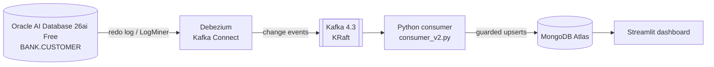

# Oracle CDC Streaming Pipeline

Real-time change data capture from **Oracle** to **MongoDB Atlas** using **Debezium** and **Kafka**, with an idempotent Python consumer, crash-recovery tests, a load test with stage-by-stage latency, and a live **Streamlit** dashboard. The whole stack starts with one command.


*Demo: one INSERT in Oracle → Debezium → Kafka → consumer → MongoDB → dashboard. About 20 seconds end to end on this laptop (the waiting part is sped up 8×); most of it is the dashboard's 5-second refresh cycle and Debezium's polling.*

> All data in this project is synthetic. Built and run on a single laptop (Docker Desktop on Windows/WSL2) with a free-tier MongoDB Atlas cluster.

---

## What it does

- Captures every **insert, update and delete** on an Oracle table from the redo log (Debezium LogMiner), with no changes to the application writing to Oracle.
- Streams the changes through **Kafka** and applies them to **MongoDB** with a consumer that is safe against **duplicates, replays, out-of-order events and crashes**.
- Shows the result on a **live dashboard** that refreshes every 5 seconds.
- Starts from scratch with **`docker compose up -d`**: Oracle is configured for CDC automatically on first start.

## Architecture



| Component | Role |
|---|---|
| Oracle AI Database 26ai Free | Source database. ARCHIVELOG + supplemental logging enabled by `oracle/startup/01_cdc_setup.sh` |
| Debezium 3.6 (Kafka Connect) | Reads committed changes from the redo log; snapshot first (`op=r`), then streams `c` / `u` / `d` |
| Kafka 4.3 (KRaft, no ZooKeeper) | Durable buffer between source and sink; one topic per table, keyed by primary key |
| `consumer_v2.py` | Applies changes to MongoDB with a version guard, soft deletes and commit-after-write |
| MongoDB Atlas | Current state of each customer, plus deletion markers |
| `dashboard.py` | Streamlit app: active/deleted counts, breakdowns, latest changes by SCN |

---

## Key results

| What | Result |
|---|---|
| Throughput (10,000-row bursts) | **237 → 308 → 430 events/sec** via batching, then parallel writers partitioned by key |
| Bottleneck found | Consumer writes to Atlas (~24s p50 when stages were first split), not Debezium (~2–4s) |
| Crash recovery | Rewound consumer offsets to simulate a crash: every replayed event **rejected as stale**, data unchanged |
| Restart | Resumes from the committed offset, nothing reprocessed |
| Correctness under load | 0 rejected / 0 lost writes across all load-test rounds |
| Clock skew (container vs host) | < 200 ms, checked before trusting cross-clock latency numbers |

---

## Quickstart

**Requirements:** Docker Desktop (about 4 GB free RAM), Python 3.10+, a MongoDB Atlas cluster (free tier is fine).

```bash
# 1. Configure
cp .env.example .env          # then fill in passwords and your MONGO_URI
pip install -r requirements.txt

# 2. Oracle JDBC driver for Debezium (not redistributed here)
#    Download ojdbc11.jar from Maven Central (com.oracle.database.jdbc:ojdbc11)
#    and place it in the repo root.

# 3. Start Oracle, Kafka and Kafka Connect (first start: about 1-2 minutes)
docker compose up -d
docker compose logs oracle-free | grep cdc-setup     # expect "... Done. Oracle is ready for Debezium."

# 4. Register the Debezium connector (safe to run again: it uses PUT)
python register_connector.py      # expect Connector: RUNNING, Task 0: RUNNING

# 5. Run the consumer, then the dashboard in another terminal
python consumer_v2.py             # expect 3 snapshot rows: op=r
python -m streamlit run dashboard.py
```

**Make a change and watch it flow:**
```bash
docker compose exec oracle-free bash -c 'sqlplus -s bank/"$BANK_PASSWORD"@//localhost:1521/FREEPDB1'
```
```sql
UPDATE bank.customer SET city = 'Jaipur' WHERE customer_id = 1;
COMMIT;
```
The consumer prints `ACCEPTED customer 1 op=u ...` and the dashboard picks it up on its next refresh.

| Command | Effect |
|---|---|
| `docker compose stop` | Stop everything, keep data |
| `docker compose up -d` | Start again (setup script detects it already ran and skips) |
| `docker compose down -v` | Delete containers **and** data for a completely fresh start |

---

## Design decisions

### 1. Idempotent upserts with a version guard
Kafka delivers **at least once**, so the consumer must handle duplicates and replays. Each MongoDB document stores the version of the last change applied (`_last_scn`, `_last_txseq`). A change is applied only if it is newer, and the check and write happen in **one atomic `update_one`**:

```python
{"_id": customer_id, "$or": [
    {"_last_scn": {"$exists": False}},
    {"_last_scn": {"$lt": scn}},
    {"_last_scn": scn, "_last_txseq": {"$lt": txseq}}]}
```
If a newer version already exists, the upsert tries to insert a duplicate `_id`, MongoDB raises `DuplicateKeyError`, and the event is counted as **stale**.

### 2. SCN alone is not enough: transaction sequence as tiebreaker
Two updates to the same row **in one Oracle transaction share the same SCN**. An SCN-only guard silently drops the second one: no error, just wrong data. I reproduced this live, then fixed it by adding Debezium's `txSeq` (position inside the transaction) as a tiebreaker.

### 3. Soft deletes
A delete marks the document `_deleted: true` **and keeps its version**. If the document were removed, a replayed older insert would have nothing to compare against and would **bring the deleted customer back**. Debezium's tombstone (empty message after a delete, used for Kafka log compaction) is skipped.

### 4. Commit offsets after the write, never before
Committing first and crashing loses events permanently. Writing first and crashing causes a replay, which the version guard makes harmless. So: **at-least-once delivery + idempotent writes**.

### 5. Reproducible setup
- **Health-checked start order**: Connect starts only when Oracle and Kafka are healthy.
- **Named volumes** so data survives container recreation.
- **Idempotent Oracle setup script** in the `startup` folder: the Oracle image ships with a pre-built database, so `setup` scripts never ran; the script now runs on every start and skips itself if the Debezium user exists.
- **Secrets only in `.env`** (git-ignored). The container reads `$BANK_PASSWORD` itself, so passwords never appear in commands.
- **`.gitattributes`** keeps the shell script in LF format so it doesn't break when cloned on Windows.

### 6. Least-privilege connector user
Debezium connects as `c##dbzuser` with only the LogMiner and catalog grants it needs, not as SYS.

---

## Load test

Each round inserts 10,000 rows into Oracle (commit every 1,000) and measures how long each change takes to reach MongoDB. Latency is split into stages using three timestamps on every event: **Oracle commit time, Kafka message time, MongoDB write completion**. One variable changed per round.

| Round | Change | Throughput | End-to-end p50 / p95 | Oracle→Kafka p50 | Kafka→MongoDB p50 / p95 | Avg batch write |
|---|---|---|---|---|---|---|
| 1 | Batch 500 | 210 ev/s | 28.0s / 51.8s | not split | not split | – |
| 2 | Batch 500, stages split | 237 ev/s | 27.2s / 45.2s | 3.8s | 23.6s / 40.8s | 2.09s |
| 3 | Batch 2000 | 308 ev/s | 22.0s / 35.9s | 3.9s | 18.1s / 31.4s | 6.41s |
| 4 | Batch 2000 + 4 parallel writers | **430 ev/s** | 16.8s / 24.7s | ~2s | 14.8s / 22.3s | 4.54s |

**What I learned**
- **Latency grew steadily during each run**: a backlog. Kafka buffered safely while the consumer caught up.
- **The consumer was the bottleneck**, not Debezium.
- **Batching has diminishing returns.** Modelling batch time as a fixed round trip plus a per-document cost gives about **0.65s per round trip + 2.9 ms per document**, so a single writer tops out around 345 ev/s.
- **Parallel writers** (batch split by `customer_id`, so one customer is always handled by the same writer and per-key order is kept) gave **1.4×, not 4×**: all writers share the same free-tier cluster and network, so the bottleneck moved to the database.

**Caveats:** single laptop and a shared free Atlas cluster, so absolute numbers are specific to this setup. Oracle commit timestamps have 1-second precision. Oracle→Kafka varied between ~2s and ~4s across runs with no Debezium changes, so it isn't compared across rounds.

---

## Failure tests

| Test | How | Result |
|---|---|---|
| Full lifecycle | Insert → update → delete customer 50001 | ACCEPTED (c), ACCEPTED (u), DELETED, tombstone skipped |
| Restart | Stop and restart the consumer with the same group | Nothing reprocessed |
| Crash replay | `kafka-consumer-groups.sh --reset-offsets --shift-by -4` | Replayed insert, update and delete all **rejected as stale**; MongoDB unchanged |
| Consumer session loss | Laptop slept mid-run | Session timed out, Kafka revoked the partition; on wake the consumer rejoined and resumed from its committed offset, no loss |

---

## Bugs and lessons along the way

- **Same-SCN updates silently dropped**: reproduced live; fixed with the `txSeq` tiebreaker. Initially the wrong value was "fixed" by an unrelated Debezium resend, which hid the bug; testing on purpose found it.
- **`kafka-python` couldn't complete group coordination with Kafka 4.3 on Windows** (bootstrap worked, partition assignment didn't); switched to `confluent-kafka`.
- **Kafka Connect refused to start** because its offsets topic had been auto-created with `cleanup.policy=delete` instead of `compact`.
- **Kafka unreachable from the host**: fixed with separate internal (`kafka:9092`) and external (`localhost:29092`) listeners.
- **Fresh database = new SCN timeline.** A rebuilt Oracle starts at lower SCNs, so writing into the old MongoDB database would reject everything as stale. The new stack writes to a separate database (`MONGO_DB`).
- **Decimal values arrived as base64** (`AQ==`): fixed with `decimal.handling.mode=string`.
- **A connector's progress is tied to its name**: re-registering under the same name skips the snapshot.

---

## Project structure

| Path | Purpose |
|---|---|
| `docker-compose.yml` | Oracle, Kafka (KRaft) and Kafka Connect with health checks and volumes |
| `oracle/startup/01_cdc_setup.sh` | Idempotent Oracle setup: ARCHIVELOG, supplemental logging, Debezium user, demo schema |
| `connector.json`, `register_connector.py` | Debezium connector config and idempotent registration (password from `.env`) |
| `consumer_v2.py` | Main consumer: version guard, soft deletes, tombstones, commit-after-write |
| `dashboard.py` | Live Streamlit dashboard |
| `consumer_load.py`, `consumer_parallel.py` | Load-test consumers (batching; parallel writers) |
| `consumer_v1.py` | First consumer (upserts with version guard, no delete handling), kept for comparison |
| `test_kafka_read.py`, `test_mongo_connect.py` | Connectivity checks |
| `.env.example` | Required settings, no real values |

## Roadmap

- [ ] **Customer 360**: add accounts and transactions tables; build one embedded document per customer from three CDC topics
- [ ] **CDC-driven embeddings**: re-embed a customer only when relevant fields change and update Atlas Vector Search, so recommendations are never stale
- [ ] **Hardening**: reconciliation script (Oracle vs MongoDB), consumer lag, dead-letter topic, chaos test during load, pytest suite
- [ ] **Cloud**: dashboard on Cloud Run with Terraform, GitHub Actions and Secret Manager
